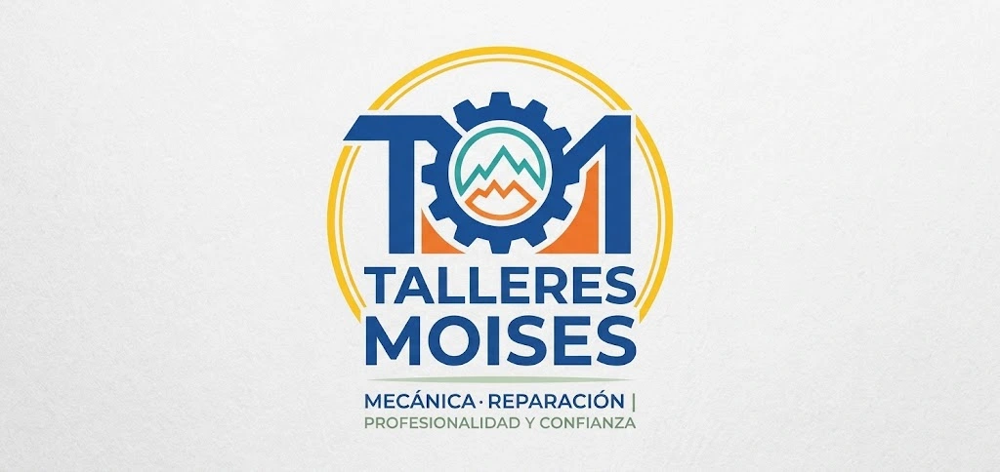

<p align="center">
  
</p>

<h1 align="center">Talleres Moises</h1>

<p align="center">
  <em>Mecánica · Reparación | Profesionalidad y confianza</em>
</p>

<p align="center">
  
  
  
  
</p>

---

## Sobre el proyecto

Proyecto de la asignatura **Desarrollo de Interfaces (2º DAM)**, UD1.
Temática: **Taller Mecánico de Vehículos**.

Web corporativa de un taller de reparación con catálogo de revisiones, tarifas orientativas y formulario de cita previa. La segunda parte del proyecto será una aplicación web (SPA) para controlar el flujo de reparaciones de los clientes.

## Páginas del sitio

| Página | Archivo | Responsable |
|--------|---------|-------------|
| Landing Page | `index.html` | Jose Manuel |
| Reserva de cita (formulario) | `pages/reserva.html` | Carmen |
| Servicios y tarifas | `pages/servicios.html` | Moises |
| Equipo y contacto | `pages/equipo.html` | Javier |

## Enlaces

- 💻 **Repositorio GitHub:** [Talleres-Moises](https://github.com/L3V1XX/Talleres-Moises)
- 🌐 **Alojamiento web:** [Web](https://talleresmoises.vercel.app/)

## Diseño

### Paleta de colores

Creada con Paletton (esquema tetrad).

| Color | Hex | Rol en Bootstrap |
|-------|-----|------------------|
|  Azul | `#1B4F9C` | `--bs-primary` |
|  Amarillo | `#ECD816` | `--bs-secondary` |
|  Violeta | `#531CA1` | `--bs-info` |
|  Naranja | `#EC9D16` | `--bs-warning` |
|  Azul oscuro | `#0F3A79` | `--bs-dark` |

### Tipografías

Cargadas en local en formato WOFF desde la carpeta `fonts/`.

- **Oswald:** títulos
- **Roboto:** texto del cuerpo
- **Montserrat:** navegación y botones

### Iconos

[Bootstrap Icons](https://icons.getbootstrap.com/) 1.11.3.

## Tecnologías

- HTML5, CSS3 y JavaScript
- [Bootstrap 5.3.3](https://getbootstrap.com/) y Bootstrap Icons
- Paleta de colores creada con [Paletton](https://paletton.com/)
- Tipografías locales en formato WOFF
- *Segunda parte:* PHP y MySQL

## Estructura del proyecto

```
Talleres-Moises/
├── css/
│   └── style.css
├── fonts/               # Oswald, Roboto y Montserrat (.woff)
├── img/
│   ├── logo/
│   ├── favicon/
│   ├── landing/
│   ├── reserva/
│   ├── servicios/
│   └── equipo/
├── js/                  # segunda parte
│   ├── ajax.js
│   ├── objetos.js
│   └── codigo.js
├── php/                 # segunda parte
│   └── config.php
├── sql/                 # segunda parte
│   ├── backup.sql
│   └── imagen_diagrama_E-R
├── pages/
│   ├── reserva.html
│   ├── servicios.html
│   └── equipo.html
├── index.html
└── README.MD
```

## Ejecución

1. Clonar el repositorio:
   ```bash
   git clone https://github.com/L3V1XX/Talleres-Moises.git
   ```
2. Abrir `index.html` en el navegador (o servir la carpeta con Live Server).
